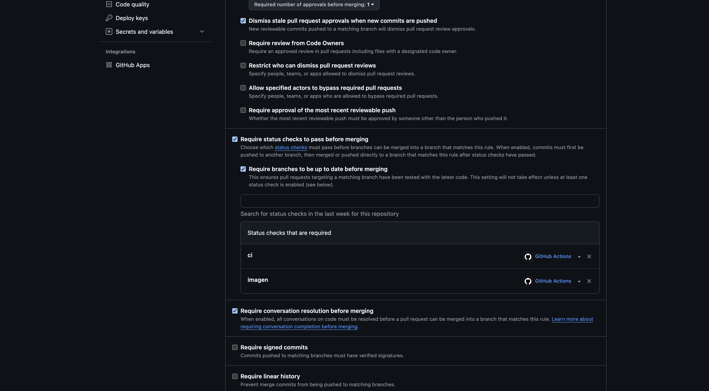
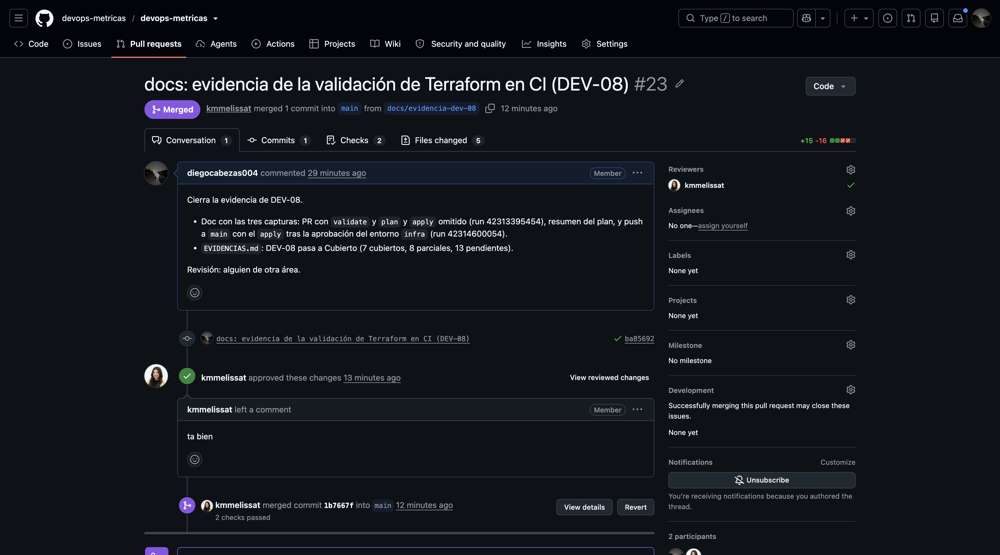

# DEV-01: Versionar aplicación, infraestructura y configuraciones no secretas en Git.

> **Cubierto.**

| | |
|---|---|
| **Responsable** | Diego |
| **Estado** | Cubierto |
| **Evidencia mínima que se revisa** | Repositorio e historial con pull requests revisados. |

## Qué hay y qué falta

Todo el código, la infraestructura (`infra/`), los manifiestos (`k8s/`) y la documentación están en Git, sin
secretos. Los cambios entran por pull request desde ramas con prefijo por tipo (`ci/`, `docs/`, `fix/`, `feat/`,
`infra/`), y el historial conserva cada PR mergeado con el ID del requisito en el título. Listado de PR:
`gh pr list --state all`.

**Protección de `main`** (Settings, Branches), activa también para administradores:

- Todo cambio entra por pull request, con **1 aprobación** de otra persona (nadie mergea su propio PR).
- Los checks **`ci`** e **`imagen`** deben pasar y la rama debe estar al día con `main`.
- Las conversaciones del PR deben estar resueltas.
- No se permiten *force-push* ni borrar la rama.

El repositorio vive en la organización `devops-metricas`.

## Evidencia

1. **Regla de protección de `main`**, con los checks requeridos y la aprobación:
   
2. **Pull request revisado y mergeado**, con la aprobación de otra persona y los checks en verde, por ejemplo el
   [PR #23](https://github.com/devops-metricas/devops-metricas/pull/23):
   

Historial completo: [pull requests cerrados](https://github.com/devops-metricas/devops-metricas/pulls?q=is%3Apr+is%3Aclosed).
