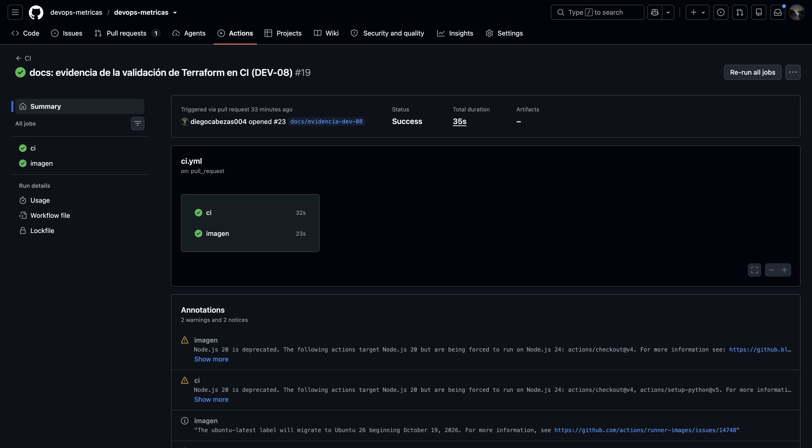
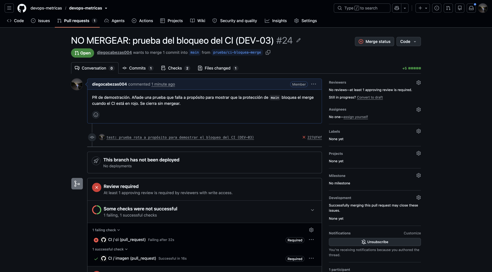

# DEV-03: Ejecutar integración continua con GitHub Actions.

> **Cubierto.**

| | |
|---|---|
| **Responsable** | Diego |
| **Estado** | Cubierto |
| **Evidencia mínima que se revisa** | Pruebas y validaciones automáticas en PR; protección de rama que bloquea la integración cuando fallan. |

## Qué hay y qué falta

[ci.yml](../../.github/workflows/ci.yml) corre en cada PR y en cada push a `main`, con permisos `contents: read`:

- Job **`ci`**: `ruff check`, `ruff format --check` y `pytest` con PostgreSQL 16 como servicio, así que también
  corren las pruebas de integración.
- Job **`imagen`**: `docker build` para verificar que el Dockerfile no se rompe.

**La protección de `main` exige `ci` e `imagen`** y bloquea el merge si alguno falla (ver [DEV-01](DEV-01-git-y-pull-requests.md)).

## Evidencia

1. **CI en verde** con los jobs `ci` e `imagen`
   ([ejecución del PR #23](https://github.com/devops-metricas/devops-metricas/actions/runs/42526293923)):
   
2. **El CI en rojo bloquea el merge.** El [PR #24](https://github.com/devops-metricas/devops-metricas/pull/24) añadió
   una prueba que falla a propósito: `ci` falla (`imagen` pasa) y GitHub bloquea el merge. Se cerró sin mergear
   y no llegó a `main` ([ejecución](https://github.com/devops-metricas/devops-metricas/actions/runs/42528846855)):
   
