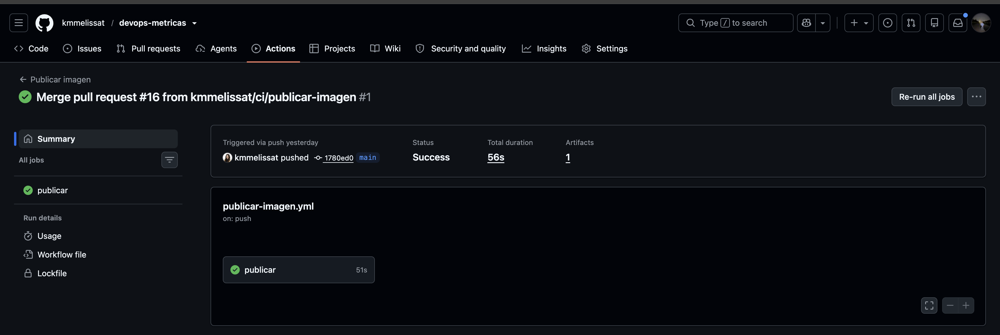
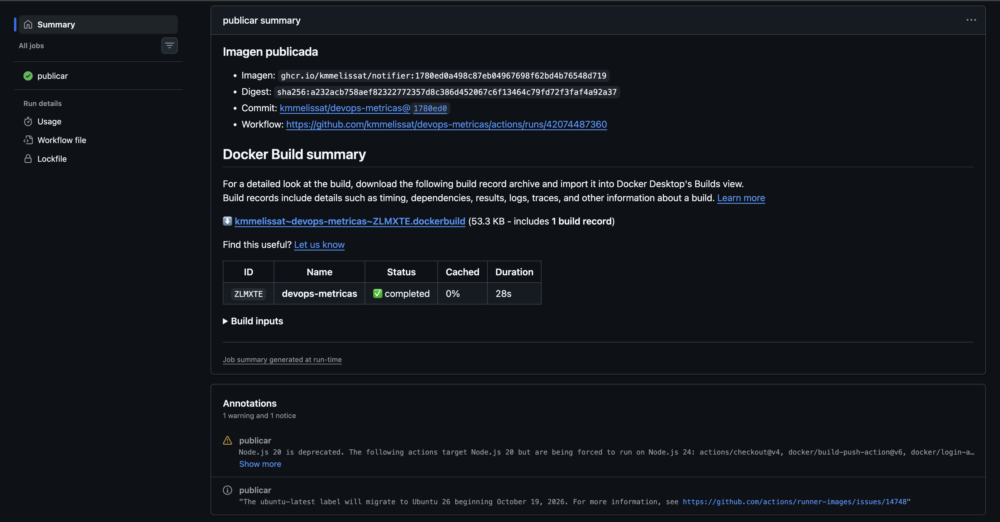
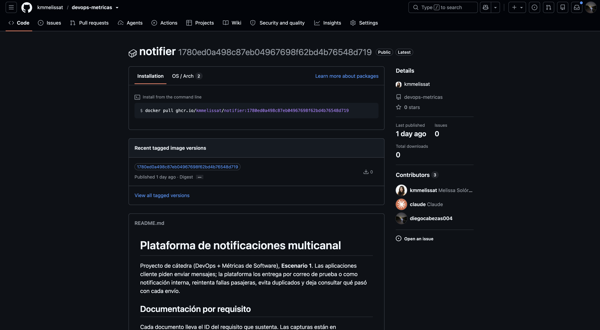

# DEV-04: Automatizar la construcción y publicación de imágenes.

> **Cubierto.**

| | |
|---|---|
| **Responsable** | Diego |
| **Estado** | Cubierto |
| **Evidencia mínima que se revisa** | Registro y vínculo entre commit, workflow e imagen desplegada. |

## Qué hay y qué falta

El workflow [publicar-imagen.yml](../../.github/workflows/publicar-imagen.yml) se ejecuta en cada push a
`main` (y a mano con `workflow_dispatch`). Construye la imagen y la publica en GHCR como
`ghcr.io/kmmelissat/notifier:<sha>`, donde `<sha>` es el SHA completo del commit.

- **Sin `latest`**: cada commit de `main` tiene su propia imagen y dev y prod siempre apuntan a un SHA concreto.
- **Permisos mínimos**: `contents: read` y `packages: write`, con el `GITHUB_TOKEN`; no hay credenciales
  propias.
- **Trazabilidad**: el SHA se pasa al Dockerfile (`GIT_SHA`) y a las etiquetas OCI
  (`org.opencontainers.image.revision` y `.source`). El resumen de la ejecución enlaza commit, workflow,
  imagen y digest.
- **Visibilidad**: el paquete es público, como el repositorio, así que K3s lo descarga sin
  `imagePullSecret`.

Falta (DEV-05): que el pipeline de entrega fije ese SHA como `newTag` en los overlays de `k8s/`.

## Evidencia

Ejecución de referencia, commit `1780ed0` (PR #16):
[actions/runs/42074487360](https://github.com/kmmelissat/devops-metricas/actions/runs/42074487360).

1. **Ejecución del workflow** en Actions:
   
2. **Resumen de la ejecución**, con imagen, digest, commit y enlace al workflow:
   
3. **Paquete en GHCR**, público y con la etiqueta `1780ed0a498c87eb04967698f62bd4b76548d719`, igual al SHA del commit:
   

Comando para descargar esa versión:

```bash
docker pull ghcr.io/kmmelissat/notifier:1780ed0a498c87eb04967698f62bd4b76548d719
```
