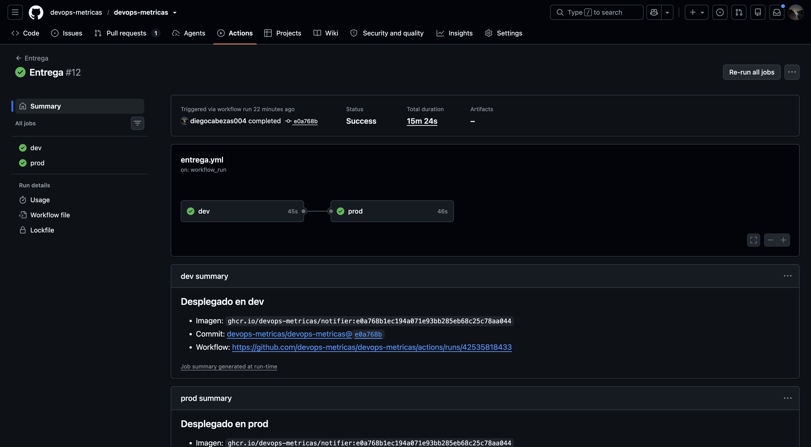
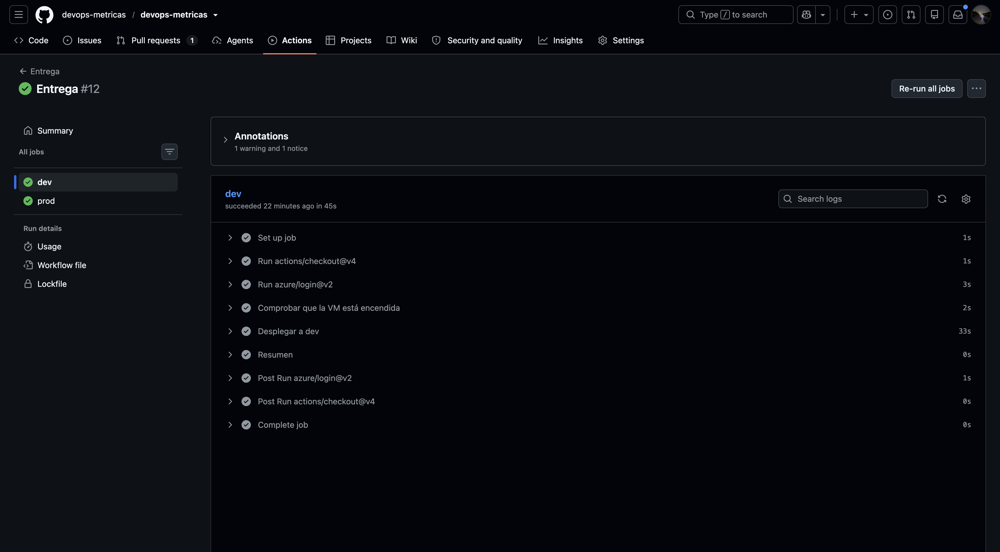
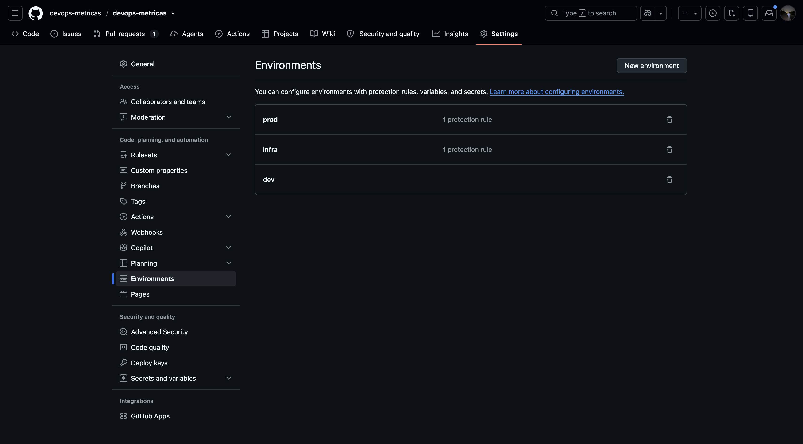
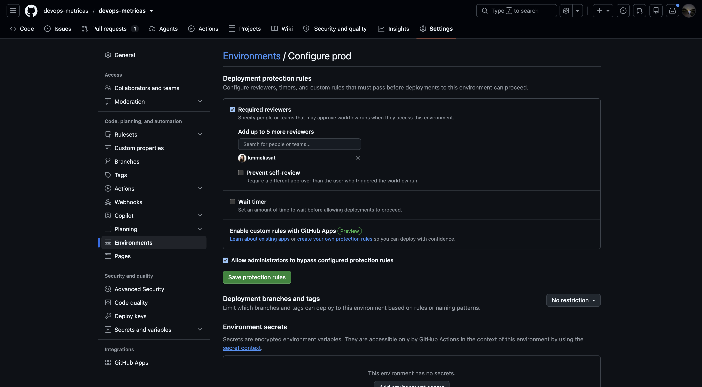
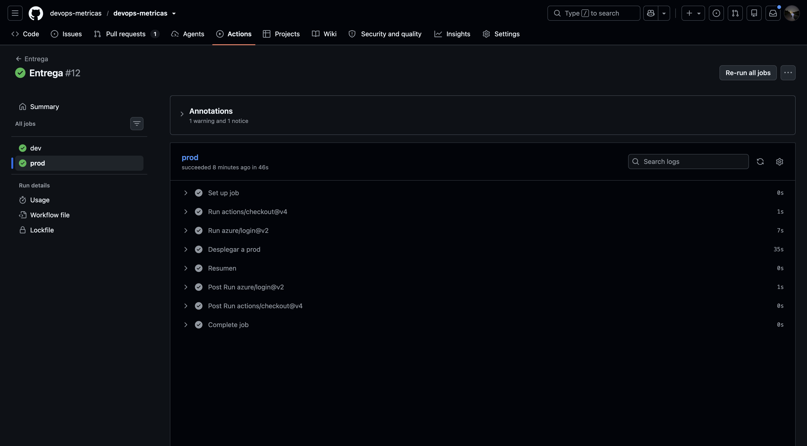

# DEV-05: Automatizar una entrega controlada, separando validación y producción de forma lógica.

> **Cubierto.**

| | |
|---|---|
| **Responsable** | Diego |
| **Estado** | Cubierto |
| **Evidencia mínima que se revisa** | Workflow, controles de aprobación y demostración de despliegue. |

## Qué hay y qué falta

[entrega.yml](../../.github/workflows/entrega.yml) y [desplegar.sh](../../scripts/desplegar.sh):

- Al terminar `Publicar imagen` en `main`, despliega a **dev** (environment `dev`, sin aprobación).
- **prod** va después y espera la aprobación del environment `prod` (revisora: `kmmelissat`).
- Despliega la imagen `ghcr.io/devops-metricas/notifier:<sha>` del commit; nunca `latest`.
- El manifiesto se aplica dentro de la VM con `az vm run-command`, porque la API de Kubernetes (6443) no
  se expone. Identidad OIDC `sp-notifier-deploy`, solo Virtual Machine Contributor.
- Antes de aplicar comprueba que la VM esté encendida: el despliegue automático se omite si está apagada (no deja
  una ejecución en rojo) y el manual falla con un mensaje claro.
- Tras aplicar espera el rollout de `api` y `worker` y comprueba `/readyz` por HTTPS.
- También se lanza a mano con un SHA (`workflow_dispatch`), que es la vía de rollback ([DEV-12](DEV-12-rollback.md)).

**Separación entre validación y producción**: la validación es dev, que se despliega solo y verifica `/readyz`; prod
solo arranca cuando dev terminó bien (`needs: dev`) y una persona la aprueba. Los controles viven en GitHub, no en el
código: el environment `prod` tiene revisora obligatoria.

**Límites del control**: en el environment `prod` está activada la opción *Allow administrators to bypass configured
protection rules* y desactivada *Prevent self-review*. Hoy las personas con rol de administrador pueden saltarse la
aprobación, y quien lanza el despliegue podría aprobarlo si fuera revisora. En esta entrega lanza Diego y aprueba
Melissa, pero el control es de proceso, no está forzado.

## Evidencia

Ejecución de referencia, commit `e0a768b`
([run 42535818433](https://github.com/devops-metricas/devops-metricas/actions/runs/42535818433)): `dev` en 45 s y
`prod` en 46 s. La duración total, 15 min 24 s, incluye la espera de la aprobación.

1. **Ejecución completa**, con `dev` y luego `prod` en verde, y el resumen que enlaza imagen, commit y workflow:
   
2. **Despliegue a dev**: se ve la comprobación de la VM, el despliegue y el resumen:
   
3. **Control de aprobación de `prod`**: el environment `prod` con revisora obligatoria (`kmmelissat`) y la lista de
   entornos (`prod` e `infra` con 1 regla, `dev` sin reglas):
   
   
4. **Despliegue a prod**, ejecutado tras la aprobación:
   

Estado de los pods y `/readyz` de ambos entornos tras el despliegue: ver [DEV-12](DEV-12-rollback.md) y
[DEV-02](DEV-02-imagenes-de-contenedor.md).
