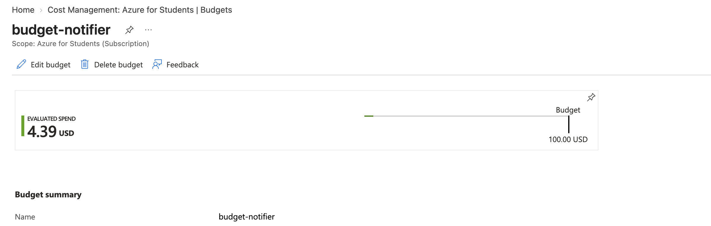
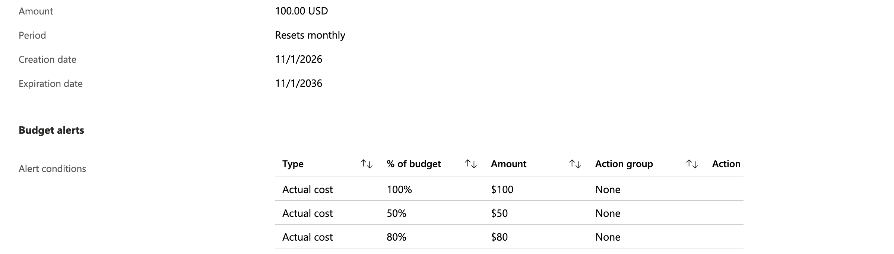
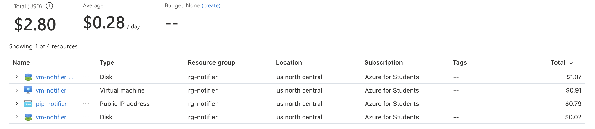

# Costos

Tope del proyecto: **US$100** acumulados en la suscripción Azure for Students (DEV-14, 5.9).

## 1. Estimación

Precios de lista de la API pública de precios de Azure (`prices.azure.com`), región `northcentralus`,
consultados en noviembre de 2026. Los créditos o descuentos de la suscripción no se descuentan, por lo
que la estimación es conservadora.

| Recurso | Precio | Cuándo cobra |
|---|---|---|
| VM `Standard_B2as_v2` (Linux) | US$0.0752 por hora | Solo encendida. **Desasignada no cobra cómputo** |
| Disco SSD estándar de 64 GB (E6, LRS) | US$4.80 al mes | Siempre, incluso con la VM apagada |
| IP pública estándar estática | US$0.005 por hora (≈ US$3.60 al mes) | Siempre, incluso con la VM apagada |
| Cuenta de almacenamiento del estado de Terraform | Centavos (un archivo pequeño) | Siempre; no medido, se confirma en Cost Management |
| Red virtual, NSG, presupuesto, apagado programado | Sin costo | — |

**Costo fijo con la VM apagada:** US$4.80 + US$3.60 ≈ **US$8.40 al mes**.

### Escenarios de un mes

| Uso de la VM | Horas | Cómputo | Fijo | Total |
|---|---|---|---|---|
| 24 horas, todo el mes (lo que **no** haremos) | 720 | US$54.14 | US$8.40 | **US$62.54** |
| 8 horas al día | 240 | US$18.05 | US$8.40 | **US$26.45** |
| 4 horas al día | 120 | US$9.02 | US$8.40 | **US$17.42** |

Incluso encendida las 24 horas, un mes completo queda en US$62.54, por debajo de los US$100. El plan
es mucho menor (entre US$17 y US$27 al mes), lo que deja margen para sesiones largas de pruebas de
carga y para las demostraciones.

No hay otros servicios de pago: PostgreSQL, Mailpit y la futura pila de observabilidad corren dentro de
la misma VM. Si el equipo agrega un servicio administrado (por ejemplo Log Analytics), debe
sumarse aquí antes de activarlo.

## 2. Medidas para reducir el gasto

1. **Apagar la VM al terminar cada sesión:** *Actions → Infra ops → `deallocate`* (ver
   [DEV-13-reconstruccion.md](DEV-13-reconstruccion.md)).
2. **Apagado automático** todos los días a las 23:00 (hora de América Central), por si alguien olvida
   el paso anterior. No lo sustituye.
3. **Alertas de presupuesto** al 50, 80 y 100 % de US$100, por correo. Solo notifican: no detienen
   nada. Verificado el 2026-11-10 con `az consumption budget list` y `az consumption budget show`:
   presupuesto `budget-notifier` de US$100 al mes, desde el 2026-11-01, con tres alertas activas
   (50, 80 y 100 %) y un gasto actual de US$4.39. En el portal solo aparece con el ámbito en la
   suscripción (con el ámbito en la cuenta de facturación muestra «Budget: None»). Capturas, recortadas
   para no mostrar datos personales:
   
   
4. **Destrucción total** al terminar el proyecto (`destroy` y luego la limpieza del bootstrap), para
   dejar la suscripción sin cargos fijos.

## 3. Cargos observados

Datos de Azure Cost Management → Cost analysis, agrupados por recurso, grupo de recursos `rg-notifier`,
noviembre de 2026.

| Fecha de consulta | Costo acumulado | Cómputo | Disco | IP pública | Estado | Observación |
|---|---|---|---|---|---|---|
| 2026-11-10 | US$2.80 | US$0.91 | US$1.09 (US$1.07 + US$0.02) | US$0.79 | Dentro de lo estimado | Promedio de US$0.28 por día |

Comparación con la estimación de la sección 1:

- **Cómputo:** US$0.91 equivalen a unas 12 horas de VM encendida (US$0.0752 por hora) en total, lo que
  confirma que la VM pasa apagada casi todo el tiempo.
- **IP pública:** US$0.79 equivalen a unas 158 horas (≈ 6,6 días) a US$0.005 por hora, coherente con
  el tiempo desde que se creó.
- **Disco:** US$1.09 en ≈ 6,6 días es coherente con US$4.80 al mes por el disco de 64 GB. El segundo
  disco (US$0.02) es un cargo menor.
- **Total:** el ritmo de los costos fijos (disco e IP) es de unos US$0.28 por día, y el cómputo solo
  suma cuando hay sesiones. Queda muy por debajo del tope de US$100.

El grupo `rg-notifier` es solo parte del gasto de la suscripción: `rg-ticket-e8669f` (US$1.65) y los
grupos de arranque y de estado de Terraform (menos de US$0.01 cada uno) también suman al tope.

## 4. Dimensionamiento de la VM

### Requests y límites definidos (`k8s/base/`)

Una réplica de cada componente por ambiente (`replicas: 1` en todos los manifiestos).

| Componente | CPU (request) | Memoria (request) | Memoria (límite) |
|---|---|---|---|
| api | 50m | 96 Mi | 256 Mi |
| worker | 50m | 96 Mi | 256 Mi |
| postgres | 100m | 256 Mi | 512 Mi |
| mailpit | 25m | 32 Mi | 128 Mi |
| **Total por ambiente** | **225m** | **480 Mi** | **1152 Mi** |
| **Dev + prod** | **450m** | **960 Mi** | **2304 Mi** |
| otel-collector (`observability`, compartido) | 25m | 64 Mi | 256 Mi |
| jaeger (`observability`, compartido) | 50m | 128 Mi | 384 Mi |
| **Aplicación + trazas** | **525m** | **1152 Mi** | **2944 Mi** |

Las trazas (MET-04) no agregan recursos de Azure: corren en la misma VM, en memoria y sin disco. Los
requests de Prometheus y Grafana (MET-03, Rene) se suman aquí cuando estén definidos.

Los manifiestos no fijan límite de CPU, solo de memoria. Los requests de las dos aplicaciones usan
unas 0,45 vCPU y menos de 1 GiB de los 2 vCPU y 8 GiB de `Standard_B2as_v2`; incluso sumando todos los
límites de memoria (2,25 GiB) queda margen para el sistema, K3s (CoreDNS, Traefik, metrics-server,
provisionador de almacenamiento) y la pila de métricas que pide el bloque MET. Una VM de 4 GB (por
ejemplo `Standard_B2s`) no dejaría margen con Prometheus y Grafana en el mismo nodo, y una de 16 GB
duplicaría el costo de cómputo sin necesidad.

### Consumo real

Medido en el clúster con `kubectl top` (metrics-server de K3s) y con cAdvisor en Prometheus. El detalle y
las tablas están en [DEV-11](DEV-11-probes-y-recursos.md) y [MET-03](../MET/MET-03-metricas-de-aplicacion.md).

- **Nodo, durante `scripts/smoke.py batch` en `dev`** (100 notificaciones): la CPU pasó de 54m (2 %) a 65m
  (3 %) y la memoria se mantuvo en 1,7 GiB (21 % de los 8 GiB).
- **Pods de la aplicación en `dev`:** entre 1m y 37m de CPU y entre 5 y 54 Mi de memoria, todos por debajo
  de sus requests.
- **Carga de 30 req/s durante 60 s** (canal `internal`, desde un PC por internet): el pico fue de unos
  0,08 cores en `api`, 0,05 en `postgres` y 0,035 en `worker`; la memoria de cada contenedor no pasó de
  unos 60 Mi. `notifier-prod`, sin tráfico, no se movió. No se encontró el punto de saturación.
- **En reposo, con el monitoreo desplegado:** unos 0,006 cores y 325 a 360 MiB por namespace de aplicación.

**Conclusión:** el nodo usa alrededor del 21 % de la memoria con la aplicación y la pila de observabilidad
corriendo. En CPU, 65m (3 %) con 100 notificaciones y unos 0,17 cores sumando los picos de los tres
pods con 30 req/s (menos del 10 % de los 2 vCPU). Hay margen suficiente para no subir de tamaño y la VM
de 8 GiB no está sobredimensionada de forma que justifique bajar a 4 GiB (Prometheus y Grafana lo
dejarían sin holgura).

**Limitación:** la cifra del nodo (1,7 GiB) es de la prueba de 100 notificaciones, no de la de 30 req/s, y el
consumo de los pods del namespace `monitoring` no se midió por separado.

K3s exige como mínimo 2 vCPU y 2 GB para un nodo servidor. Se eligieron 8 GB porque en el mismo nodo
deben convivir dev, prod, PostgreSQL, Mailpit y la observabilidad.
