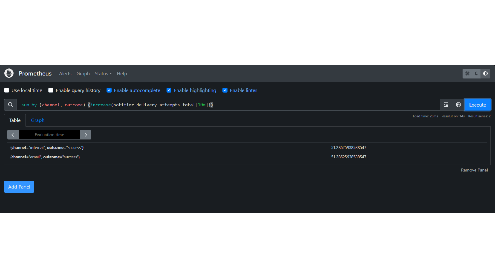
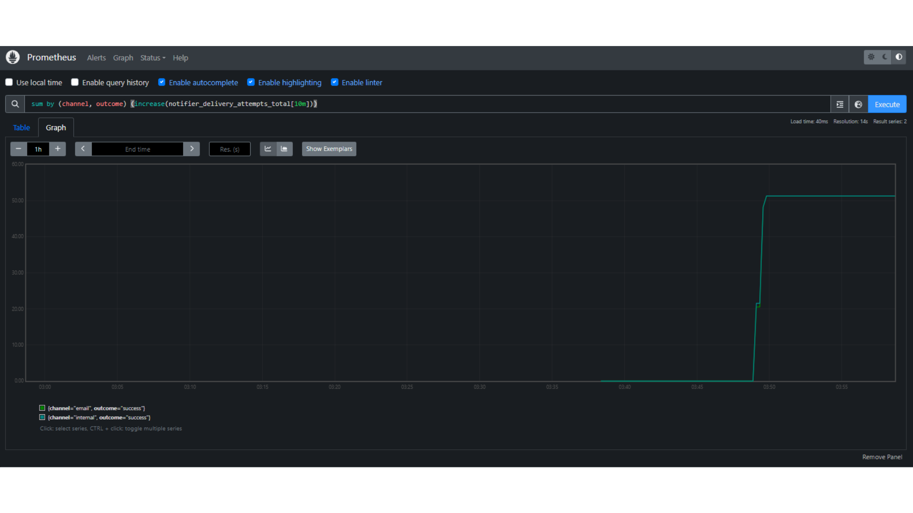
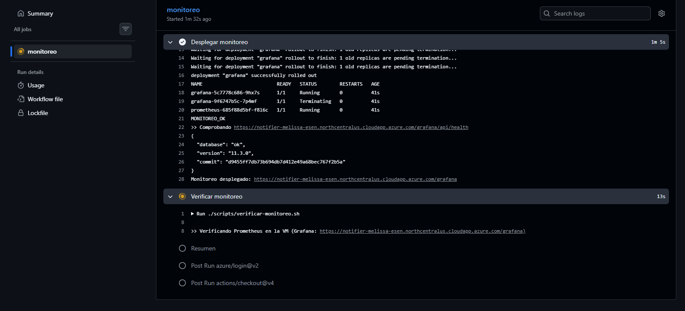
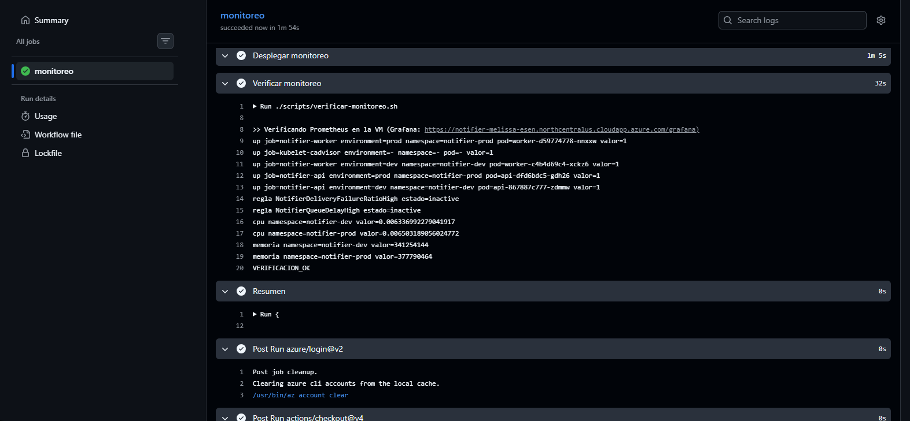
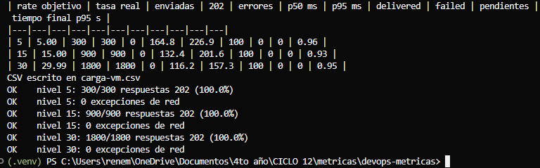
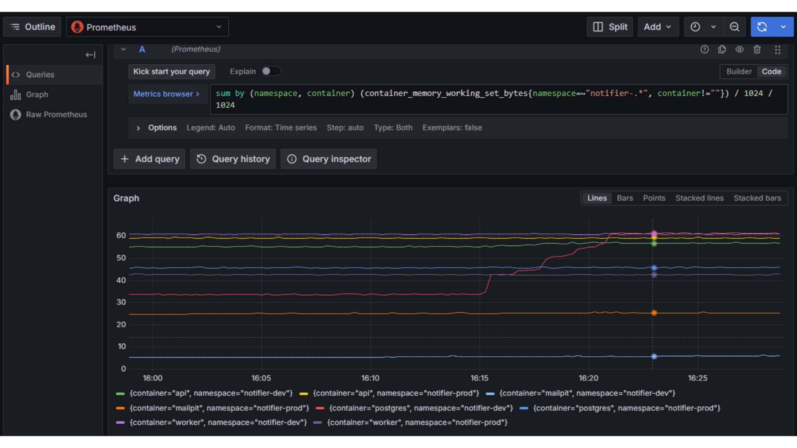
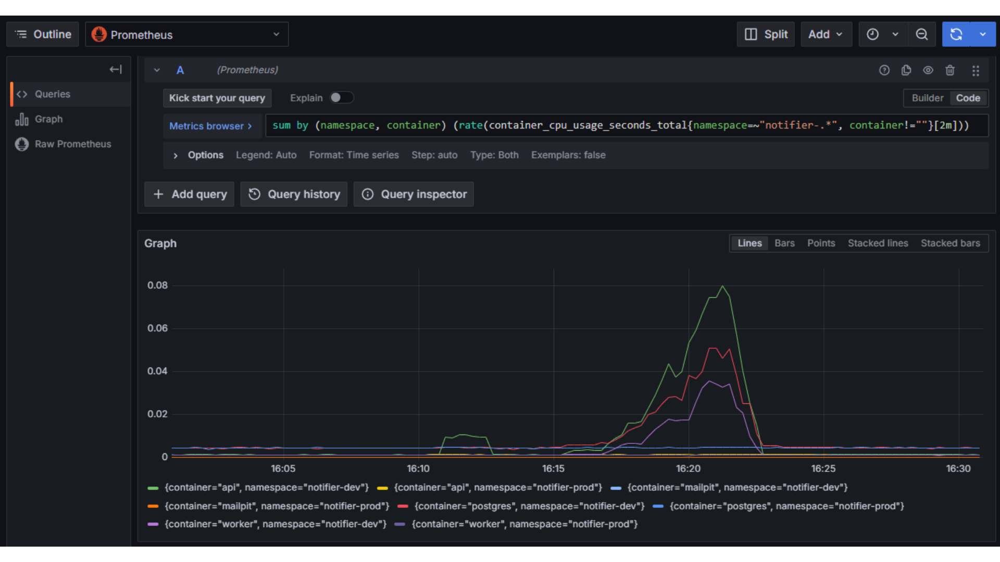

# MET-03: Instrumentar métricas de aplicación y relacionarlas con métricas de infraestructura.

> **Cubierto.**

| | |
|---|---|
| **Responsable** | Rene |
| **Estado** | Cubierto |
| **Evidencia mínima que se revisa** | Consultas y series temporales verificables. |

## Qué hay y qué falta

Prometheus v2.55.1 y Grafana 11.3.0 están en [docker-compose.monitoring.yml](../../docker-compose.monitoring.yml).
La recolección está en [monitoring/prometheus.yml](../../monitoring/prometheus.yml): `scrape_interval` 15 s y
`evaluation_interval` 15 s. Dos jobs, ambos con la etiqueta `environment=local`:

| Job | Destino |
|---|---|
| `notifier-api` | `host.docker.internal:8000` |
| `notifier-worker` | `host.docker.internal:9100` |

Las métricas de aplicación se definen en [src/notifier/observability.py](../../src/notifier/observability.py):

| Métrica | Tipo | Labels |
|---|---|---|
| `notifier_notifications_accepted_total` | contador | `client`, `channel` |
| `notifier_idempotent_replays_total` | contador | `client`, `channel` |
| `notifier_idempotency_conflicts_total` | contador | `client`, `channel` |
| `notifier_delivery_attempts_total` | contador | `channel`, `outcome` (`success`, `transient_error`, `permanent_error`) |
| `notifier_notifications_finished_total` | contador | `channel`, `status` |
| `notifier_delivery_attempt_duration_seconds` | histograma | `channel` |
| `notifier_end_to_end_seconds` | histograma | `channel`; buckets de 0,5 s a 300 s |
| `notifier_queue_depth` | gauge | `status` |
| `notifier_oldest_pending_age_seconds` | gauge | sin labels |

En Prometheus también se comprobaron las métricas HTTP de `prometheus-fastapi-instrumentator`:
`http_requests_total{handler,method,status}`, con `status` agrupado en `2xx`, `4xx` y `5xx`, y
`http_request_duration_highr_seconds_bucket`, que no trae el label `handler`.

En Windows local `process_*` no aparece: esas series solo existen en Linux. El monitoreo ya está
desplegado en K3s (namespace `monitoring`, manifiestos en [k8s/monitoring](../../k8s/monitoring)).
Prometheus descubre los pods de `notifier-dev` y `notifier-prod` como jobs `notifier-api` y
`notifier-worker`, con labels `environment`, `namespace` y `pod`, y lee el nodo con `kubelet-cadvisor`.
La infraestructura sale de cAdvisor (`container_*`) y de `process_*`. Grafana queda en
`https://<FQDN>/grafana`, con FQDN = `<TF_DNS_LABEL>.northcentralus.cloudapp.azure.com`.

## Evidencia

Consulta en Prometheus, ventana de 10 min:

```
sum by (channel, outcome) (increase(notifier_delivery_attempts_total[10m]))
```

La tabla devuelve dos series, las dos en `outcome="success"`, con el mismo valor **51,286…** (51,29):
`channel="email"` y `channel="internal"`. La casilla *Evaluation time* está tapada: la tabla no muestra
la hora de la evaluación.



La misma consulta en gráfico, con *Use local time* desmarcado. El eje va de 03:00 a 03:55. Las dos series
van superpuestas: permanecen en 0 y suben en un escalón hasta unos 51 entre las 03:45 y las 03:50.



### Evidencia en K3s (10/11/2026)

Horas locales de El Salvador (UTC−6). Grafana: `https://<FQDN>/grafana`.

**Observado.** El workflow Monitoreo #1 corrió sobre `main` desde las 15:54. Prometheus y Grafana están
en el namespace `monitoring`, con los pods en 1/1 Running y la marca `MONITOREO_OK`. `GET /grafana/api/health`
respondió `database ok` y versión 11.3.0.



La verificación del mismo run terminó en `VERIFICACION_OK`. `up` vale 1 para `notifier-api` y
`notifier-worker` en `notifier-dev` y en `notifier-prod`, y para `kubelet-cadvisor`. Las reglas
`NotifierDeliveryFailureRatioHigh` y `NotifierQueueDelayHigh` estaban cargadas e inactive. En reposo, la
CPU era 0,00634 cores en `notifier-dev` y 0,00650 cores en `notifier-prod`. La memoria era 341254144 bytes
y 377790464 bytes (unos 325 y 360 MiB).



`scripts/carga.py` se lanzó desde un PC por internet contra la API de dev en la VM, canal `internal`,
60 s por nivel. El nivel de 5 req/s empezó a las 16:16:35 y el de 30 req/s a las 16:19:40. El tiempo
final se mide con `created_at` y `delivered_at` del servidor, no con el reloj del script. La latencia
p50 y p95 de la tabla es del cliente e incluye la red. En total fueron 3000 solicitudes, 0 errores, y en
la muestra 0 `failed` y 0 pendientes.

| Nivel | Tasa real | Enviadas | 202 | Errores | p50 cliente | p95 cliente | Muestra | Tiempo final p95 |
|---|---|---|---|---|---|---|---|---|
| 5 req/s | 5,00 | 300 | 300 | 0 | 164,8 ms | 226,9 ms | 100 delivered | 0,96 s |
| 15 req/s | 15,00 | 900 | 900 | 0 | 132,4 ms | 201,6 ms | 100 delivered | 0,93 s |
| 30 req/s | 29,99 | 1800 | 1800 | 0 | 116,2 ms | 157,3 ms | 100 delivered | 0,95 s |



El CSV de la misma corrida está en [MET-03-carga-vm.csv](../evidencias/MET-03-carga-vm.csv).

En Explore, 30 min, la memoria de cAdvisor
`sum by (namespace, container) (container_memory_working_set_bytes{namespace=~"notifier-.*", container!=""}) / 1024 / 1024`
tiene el eje en MiB y 8 series, entre unos 5 y 60 MiB. La de postgres en `notifier-dev` sube de unos 33
a unos 60 MiB entre las 16:15 y las 16:21, aproximadamente. Las series de `notifier-prod` no se mueven.



La CPU
`sum by (namespace, container) (rate(container_cpu_usage_seconds_total{namespace=~"notifier-.*", container!=""}[2m]))`
tiene el eje en cores. En `notifier-dev`, entre las 16:16 y las 16:23, el pico es de unos 0,08 cores en
`api`, unos 0,05 en postgres y unos 0,035 en `worker`. `notifier-prod` no se mueve. Antes de la carga,
entre las 16:11 y las 16:13, la API de `notifier-dev` muestra un bulto de unos 0,01 cores.



**Interpretación.** Hasta 30 req/s no hay saturación. Durante la carga suben CPU y memoria en
`notifier-dev` y `notifier-prod` permanece quieto, que es el namespace que no recibió tráfico. El tiempo
final p95 de 0,93 a 0,96 s está medido con las marcas del servidor.

**Hipótesis.** No verificada: el bulto de unos 0,01 cores de la API de `notifier-dev` entre las 16:11 y
las 16:13, antes de la carga, podría ser tráfico de otra persona del equipo. La captura no lo identifica.
No se afirma como hecho.

**Limitaciones.** Todo el tráfico fue por el canal `internal`; el correo no se probó en la VM. La carga
salió de un solo PC por internet. No se encontró el punto de saturación. La latencia del cliente incluye
la red. El consumo de los pods del namespace `monitoring` no se midió en esta sesión.

## Interpretación

El lote real fue de 50 envíos por canal. `increase()` extrapola en los bordes de la ventana, y por eso el
valor no es 50 sino 51,29. El eje del gráfico está en UTC: las 03:48 UTC son las 21:48, hora de El
Salvador (UTC−6).

## Hipótesis

No hay una hipótesis aparte sobre esa serie: la diferencia entre 50 y 51,29 es el efecto de `increase()`,
ya contrastado con el tamaño del lote.

La relación con la infraestructura está observada en K3s, en la subsección anterior. La hipótesis que
sigue abierta es solo el bulto de CPU anterior a la carga, y allí está dicha como no verificada.
