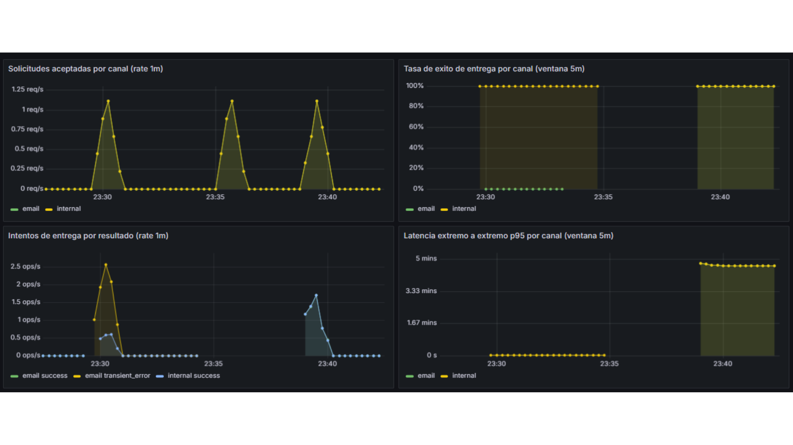
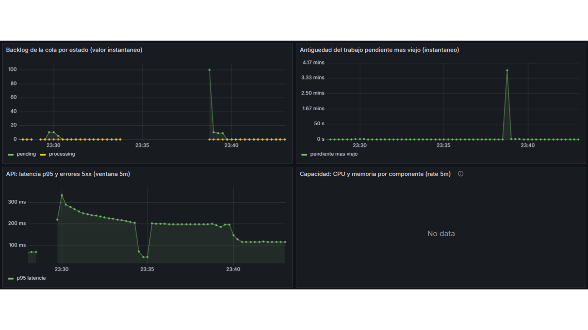
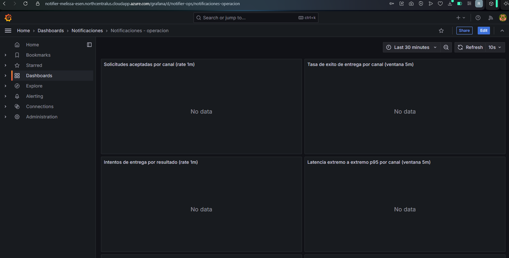
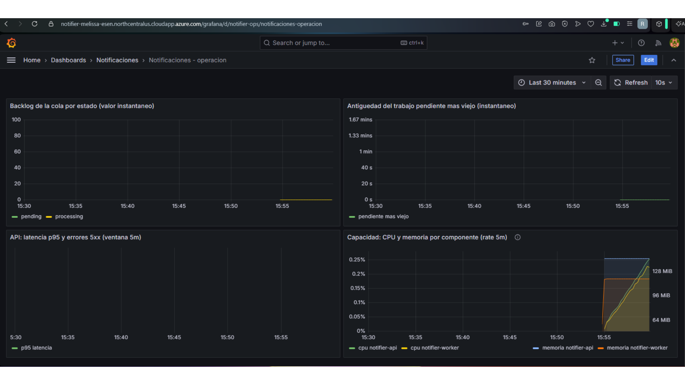
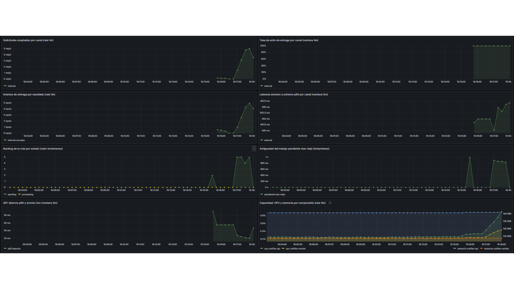
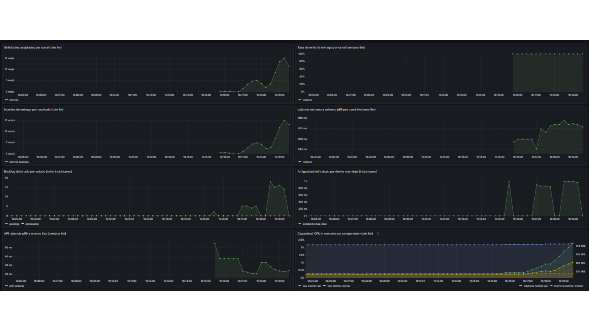
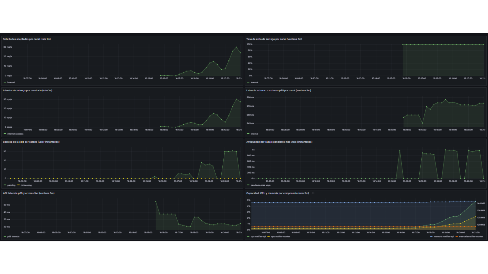

# MET-05: Construir dashboards que respondan preguntas operativas concretas.

> **Cubierto.**

| | |
|---|---|
| **Responsable** | Rene |
| **Estado** | Cubierto |
| **Evidencia mínima que se revisa** | Paneles interpretables, con unidades y ventanas temporales. |

## Qué hay y qué falta

El dashboard **Notificaciones - operacion** (`uid` `notifier-ops`) se provisiona desde
[monitoring/grafana/dashboards/notifier.json](../../monitoring/grafana/dashboards/notifier.json). El rango
por defecto es 30 min y el refresco es de 10 s. Tiene ocho paneles de serie temporal. Cada uno lleva la
unidad y la ventana en el título.

| Panel | Pregunta operativa | Consulta PromQL | Unidad | Ventana |
|---|---|---|---|---|
| 1. Solicitudes aceptadas por canal | ¿A qué ritmo se aceptan solicitudes, por canal? | `sum by (channel) (rate(notifier_notifications_accepted_total[1m]))` | reqps | 1 m |
| 2. Tasa de éxito de entrega por canal | ¿Qué fracción de los finales es una entrega, por canal? | `sum by (channel) (increase(notifier_notifications_finished_total{status="delivered"}[5m])) / sum by (channel) (increase(notifier_notifications_finished_total[5m]))` | percentunit | 5 m |
| 3. Intentos de entrega por resultado | ¿Cómo se reparten los intentos según el resultado? | `sum by (channel, outcome) (rate(notifier_delivery_attempts_total[1m]))` | ops | 1 m |
| 4. Latencia extremo a extremo p95 por canal | ¿Cuál es el p95 desde la aceptación hasta la entrega, por canal? | `histogram_quantile(0.95, sum by (le, channel) (rate(notifier_end_to_end_seconds_bucket[5m])))` | s | 5 m |
| 5. Backlog de la cola por estado | ¿Cuántos trabajos hay en cola, por estado? | `sum by (status) (notifier_queue_depth)` | short | instantáneo |
| 6. Antigüedad del trabajo pendiente más viejo | ¿Cuánto lleva esperando el pendiente más viejo? | `max(notifier_oldest_pending_age_seconds)` | s | instantáneo |
| 7. API: latencia p95 y errores 5xx | ¿Cuál es el p95 de la API y a qué ritmo hay errores 5xx? | `histogram_quantile(0.95, sum by (le) (rate(http_request_duration_highr_seconds_bucket{job="notifier-api"}[5m])))` y `sum(rate(http_requests_total{job="notifier-api",status="5xx"}[5m]))` | s y reqps | 5 m |
| 8. Capacidad: CPU y memoria por componente | ¿Cuánta CPU y memoria residente usa cada componente? | `sum by (job) (rate(process_cpu_seconds_total{job=~"notifier-.*"}[5m]))` y `sum by (job) (process_resident_memory_bytes{job=~"notifier-.*"})` | percentunit y bytes | 5 m en la CPU; la memoria es el valor instantáneo |

En Windows el panel 8 sale vacío porque `process_*` solo existe en Linux. En K3s ya tiene datos; el
detalle está en la evidencia del 10/11/2026. Grafana se publica en `https://<FQDN>/grafana`, con
FQDN = `<TF_DNS_LABEL>.northcentralus.cloudapp.azure.com`.

## Evidencia

Capturas tomadas a las 23:43, hora local del 9/11/2026, con el rango de los últimos 15 minutos (no es el
rango por defecto de 30 min). El recorte muestra los paneles; el selector de tiempo no entra en la imagen.

Mitad superior. A las 23:30 la tasa de éxito del correo cae a 0 % y el canal `internal` sigue en 100 %.
En intentos, el `transient_error` del correo llega a unos 2,5 intentos/s. Hacia las 23:40 el p95 extremo
a extremo de `internal` sube a unos 4,7 min.

Mitad inferior. En el backlog hay un hueco sin datos entre ~23:34 y ~23:38; hacia las 23:39 la serie
`pending` salta a 100. La antigüedad del pendiente más viejo llega a unos 3,8 min en ese mismo momento.
El p95 de la API (la serie visible es «p95 latencia») se mueve entre unos 50 ms y unos 330 ms. El panel
de capacidad muestra **No data**.

### Evidencia en K3s (10/11/2026)

Horas locales de El Salvador (UTC−6). El dashboard `notifier-ops` se miró con ventana de 30 min y
refresco de 10 s, en `https://<FQDN>/grafana`.

**Observado, en reposo.** Los paneles 1 a 4 están en No data, sin tráfico. En la mitad inferior el eje
va de 15:30 a 15:55: el backlog está en 0, la antigüedad en 0 y el p95 de la API vacío. El panel de
capacidad tiene datos desde las 15:54, cuando Prometheus empezó a leer.

**Observado, durante la carga** (la misma de [MET-03](MET-03-metricas-de-aplicacion.md), canal
`internal`). La tasa de éxito está en 100 %. Los intentos de entrega son todos `success` y del orden de
la tasa enviada. El backlog llega como máximo a unos 5, 18 y 30 pendientes en los tres niveles y vuelve
siempre a 0. La antigüedad del pendiente más viejo llega como máximo a unos 1 s. El p95 de la API se
mueve entre unos 20 y 55 ms; el valor de 55 ms es de la prueba corta previa. El p95 extremo a extremo
queda plano entre unos 945 y 960 ms. En el panel de capacidad, la CPU de `notifier-api` está por debajo
del 5 % y la de `notifier-worker` cerca del 2 %; la memoria alrededor de 144 MiB. Ese panel usa
`process_cpu_seconds_total` y `process_resident_memory_bytes` agrupadas por job, así que suma dev y prod.

**Interpretación.** Hasta 30 req/s no hay saturación: el backlog se vacía en cada ciclo de 1 s del worker
y la latencia de la API no crece con la carga. El máximo de pendientes (unos 5, 18 y 30) es del orden de
la llegada por segundo, coherente con esa consulta de la cola cada 1 s. El p95 extremo a extremo de unos
0,95 s es real, no un artefacto del histograma: `scripts/carga.py` mide 0,93 a 0,96 s con `created_at` y
`delivered_at` del servidor, y encaja con un reparto uniforme de la espera entre 0 y 1 s del ciclo del
worker. Con esta carga, `NotifierQueueDelayHigh` (más de 30 s) y `NotifierDeliveryFailureRatioHigh` (más
del 20 %) no podían cumplirse según los paneles: la cola máxima ronda 1 s y el éxito está en 100 %. Eso
se infiere de estos paneles, no de una captura de la página de alertas durante la carga.

**Hipótesis.** Esta subsección no agrega una hipótesis propia. La de la evidencia local, sobre los 7 s
del canal `internal` durante la falla del correo, sigue sin verificar y no usa estas capturas.

**Limitaciones.** Todo el tráfico fue por el canal `internal`; el correo no se probó en la VM. La carga
salió de un solo PC por internet. No se encontró el punto de saturación. El dashboard no tiene variable
de entorno y agrupa dev y prod; prod no tuvo tráfico. La latencia del cliente de la tabla de MET-03
incluye la red. El consumo de los pods del namespace `monitoring` no se midió en esta sesión.

## Interpretación

El hueco y el backlog de 100 corresponden a que el worker estuvo detenido por el operador, de ~23:32 a
~23:38, durante la demostración de alertas de [MET-06](MET-06-alertas.md). Al reiniciarse procesó de
golpe lo acumulado. Es evidencia real del efecto de una caída del worker, y de que sus series desaparecen
mientras está caído.

El p95 extremo a extremo queda cerca del último bucket del histograma (300 s). Está saturado: no es un
valor exacto.

## Hipótesis

No verificada: durante la falla del correo, el p95 del canal `internal` habría subido a unos 7 s porque
el worker procesa los trabajos en secuencia y los reintentos de correo le compiten el tiempo. Estas dos
capturas no muestran ese valor. En el panel de latencia extremo a extremo, `internal` sigue cerca de 0 s
a las 23:30; el salto que sí se ve es el de unos 4,7 min hacia las 23:39.
