# MET-06: Configurar alertas vinculadas a condiciones justificadas.

> **Cubierto.** Dos alertas justificadas; `NotifierDeliveryFailureRatioHigh` demostrada en K3s pasando por pending, firing y resuelta.

| | |
|---|---|
| **Responsable** | Rene |
| **Estado** | Cubierto |
| **Evidencia mínima que se revisa** | Regla, evidencia de activación y explicación de posibles falsos positivos. |

## Qué hay y qué falta

Dos reglas en [monitoring/alerts.yml](../../monitoring/alerts.yml), grupo `notifier-alerts`, intervalo de
evaluación 30 s. `promtool` las aceptó: `SUCCESS: 2 rules found`.

| Regla | Expresión | Umbral | Ventana de la consulta | Intervalo de evaluación | Periodo pendiente (`for`) | Severidad | Justificación | Falsos positivos |
|---|---|---|---|---|---|---|---|---|
| `NotifierDeliveryFailureRatioHigh` | `sum by (channel) (rate(notifier_delivery_attempts_total{outcome!="success"}[2m])) / sum by (channel) (rate(notifier_delivery_attempts_total[2m]))` y `sum by (channel) (rate(notifier_delivery_attempts_total[2m]))` | ratio > 0,20 y tráfico > 0,02 intentos/s | 2 min (8 scrapes de 15 s; basta para que `rate()` no oscile) | 30 s (evaluar más rápido que el scrape de 15 s no aporta datos nuevos) | 1 min (no dispara por un pico corto) | critical | Más del 20 % de los intentos del canal fallan, con un mínimo de tráfico para no reaccionar al vacío | Con poco tráfico un solo fallo da un ratio alto; el mínimo de 0,02 intentos/s lo recorta |
| `NotifierQueueDelayHigh` | `max(notifier_oldest_pending_age_seconds)` | > 30 s | instantáneo | 30 s | 2 min | warning | El máximo normal observado fue unos 2,3 s; 30 s es más de diez veces lo habitual | Un solo trabajo viejo basta, aunque el resto de la cola esté al día |

Limitaciones de `NotifierQueueDelayHigh`, ya escritas en la regla:

- Esa métrica solo la publica el worker. Si el worker se detiene, la serie desaparece y la regla no
  dispara. Se vio en el panel de backlog de [MET-05](MET-05-dashboards.md): hueco entre ~23:34 y ~23:38.
- Solo cuenta trabajos listos para procesar (`next_attempt_at <= now()`). Los reintentos en espera de
  backoff (5 s, 10 s) no suben el valor.

La regla está definida y justificada. Su disparo no se demostró.

Otros falsos positivos de la regla de entregas: la alerta se cierra sola si el tráfico cae por debajo del
mínimo, y un fallo transitorio que luego se reintenta con éxito cuenta como intento fallido. La regla
mira intentos, no el estado final de la notificación.

`NotifierDeliveryFailureRatioHigh` ya se demostró en K3s, en el incidente de
[MET-07](MET-07-incidente-controlado.md). **Falta** el disparo de `NotifierQueueDelayHigh`: habría que
degradar la capacidad del worker, no el proveedor de correo.

## Evidencia

Demostración de `NotifierDeliveryFailureRatioHigh` con el worker local en
`NOTIFIER_EMAIL_FAULT_RATE=1.0` y `NOTIFIER_EMAIL_FAULT_KIND=503`. Las capturas no muestran el reloj del
sistema. La hora se toma del campo *Active Since* y de la serie `ALERTS` de Prometheus.

Antes de la falla las dos reglas están inactivas (Inactive 2, Pending 0, Firing 0), cargadas desde
`/etc/prometheus/alerts.yml`, grupo `notifier-alerts`.

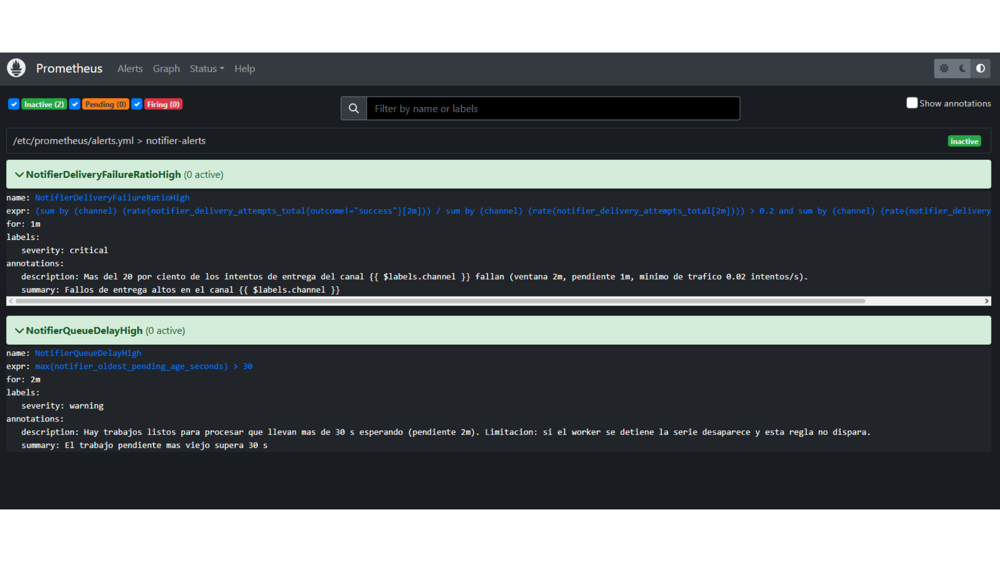

`NotifierDeliveryFailureRatioHigh` pasa a pending para `channel=email` y `severity=critical`. *Active
Since* es `2026-11-10T05:29:45Z`, es decir las 23:29:45 del 9/11/2026 en El Salvador (UTC−6).
`NotifierQueueDelayHigh` sigue en 0 active.

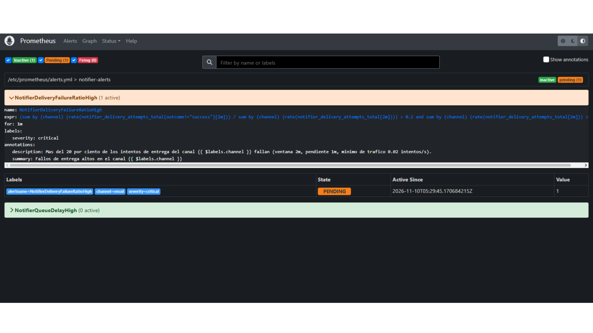

La misma alerta en firing. El *Active Since* no cambia: el paso a firing no tiene otro reloj en la
imagen. `NotifierQueueDelayHigh` sigue inactiva.

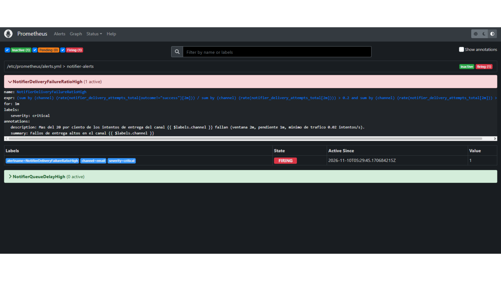

Consulta de los intentos, eje en UTC, *Use local time* desmarcado:

```
sum by (channel, outcome) (increase(notifier_delivery_attempts_total[5m]))
```

En el canal `email`, la serie `success` cae a 0 hacia las 05:24 UTC y la serie `transient_error` sube a
partir de las 05:29 UTC (23:29 hora local).

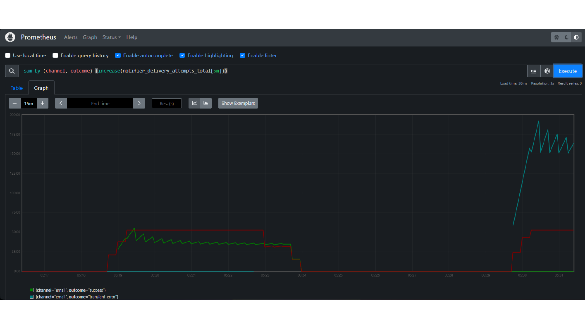

Después, las dos reglas vuelven a inactive. Esta captura tampoco muestra una hora.

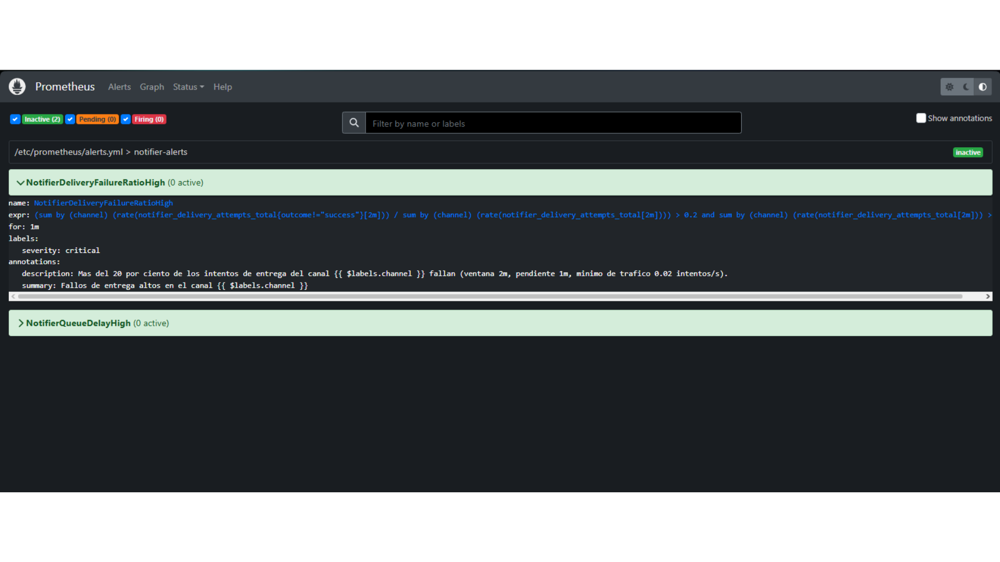

Línea de tiempo de la corrida del 9/11/2026, hora local de El Salvador (UTC−6):

| Hora local | Hecho |
|---|---|
| 23:29:00 | El worker arranca con la falla |
| 23:29:45 | La alerta pasa a pending (*Active Since* `2026-11-10T05:29:45Z`) |
| ~23:30:45 | Pasa a firing: el pending más el `for` de 1 min |
| ~23:32:20 | La serie firing termina, según `ALERTS` |

Corrida anterior, leída de la misma serie `ALERTS`:

| Hora local | Hecho |
|---|---|
| 23:09:01 | Arranque con la falla |
| 23:10:45 | Pending |
| ~23:11:45 | Firing |
| ~23:13:15 | Fin de firing |

### Verificación en K3s (10/11/2026)

Horas locales de El Salvador (UTC−6). En el mismo run del workflow Monitoreo #1, la verificación terminó
en `VERIFICACION_OK`.

**Observado.** `NotifierDeliveryFailureRatioHigh` y `NotifierQueueDelayHigh` estaban cargadas y las dos
inactive. La captura es la de la verificación, anterior a la carga de las 16:16; no es la página de
alertas durante la carga.

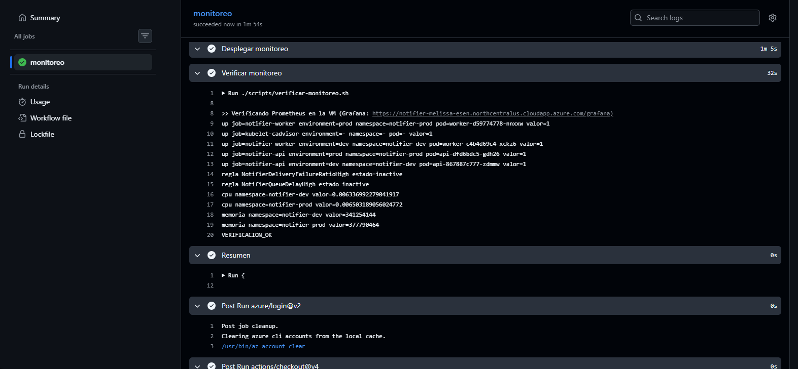

**Interpretación.** Con la carga de [MET-05](MET-05-dashboards.md) esas reglas no podían cumplirse según
los paneles: la antigüedad del pendiente más viejo ronda 1 s, por debajo de los 30 s de
`NotifierQueueDelayHigh`, y el éxito de entrega está en 100 %, por debajo del 20 % de fallos de
`NotifierDeliveryFailureRatioHigh`. Es una inferencia de los paneles, no una captura de alertas durante
la carga.

**Hipótesis.** El disparo y la recuperación con tráfico sostenido ya se demostraron en K3s; está en la
subsección siguiente. Solo falta el disparo de `NotifierQueueDelayHigh`.

### Demostración en K3s con el incidente de MET-07 (10/11/2026)

Horas locales de El Salvador (UTC−6), estimadas a partir de las gráficas con margen de un minuto. La
línea de tiempo exacta de la salida del script está en
[MET-07](MET-07-incidente-controlado.md). El incidente fue una falla del proveedor de correo al 60 %,
con tráfico de unos 1,8 req/s sostenido.

| Hora (aprox.) | Evento | Evidencia |
|---|---|---|
| ~18:37 | Inicio del tráfico (base, éxito 100 %) | [incidente, arriba](../evidencias/MET-06-k3s-incidente-completo-arriba.png) |
| ~18:42 | Se activa la falla y la alerta pasa a pending | [pending](../evidencias/MET-06-k3s-alerta-pending.png) |
| ~18:43 | Pasa a firing | [pending a firing](../evidencias/MET-06-k3s-alerta-pending-a-firing.png) |
| ~18:47 | Se quita la falla y `transient_error` cae a 0 | [incidente, abajo](../evidencias/MET-06-k3s-incidente-completo-abajo.png) |
| ~18:49 | La serie firing termina (alerta resuelta) | [resuelta](../evidencias/MET-06-k3s-alerta-resuelta.png) |
| ~18:52 | Termina el tráfico | [incidente, arriba](../evidencias/MET-06-k3s-incidente-completo-arriba.png) |

**Observado.** `NotifierDeliveryFailureRatioHigh` con `{channel="email", severity="critical"}` pasó de
pending a firing y luego a resuelta. El canal `internal` no se activó. El éxito del email en la ventana
de 5 min bajó hasta ~77 % (~18:46) y volvió a 100 %. La latencia p95 del email llegó a ~25 s y volvió a
~1 s. El backlog máximo fue de ~15 pendientes y volvió a ~0. La antigüedad del pendiente más viejo se
mantuvo bajo ~1 s. La CPU máxima fue ~1,1 %.

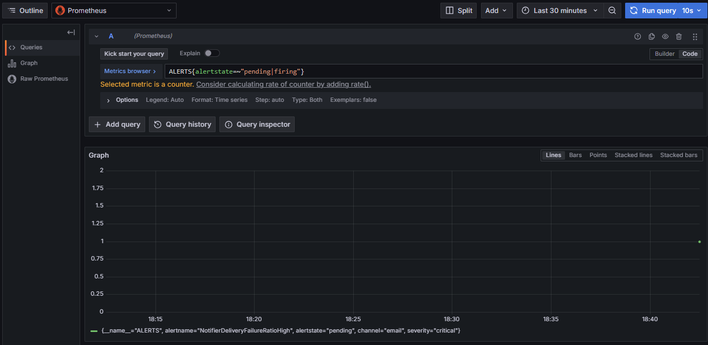

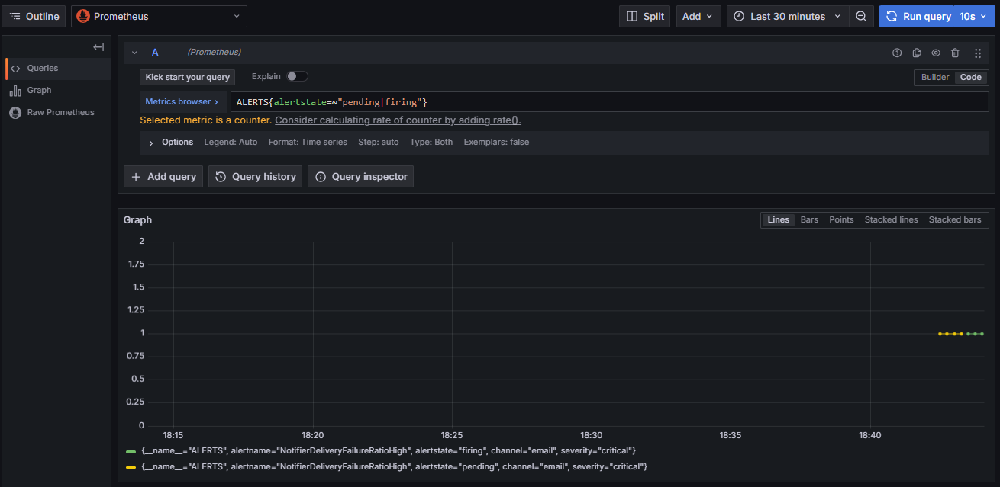

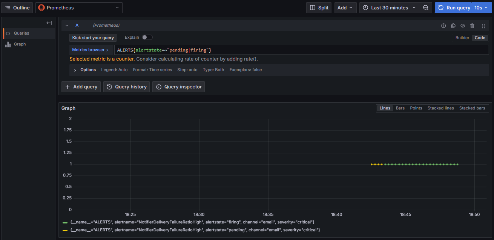

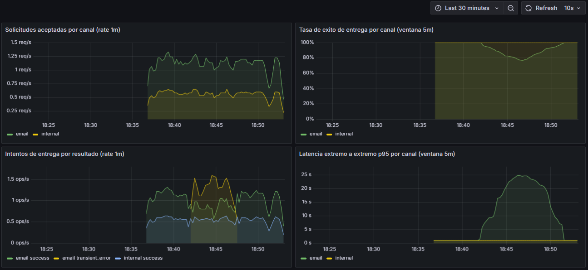

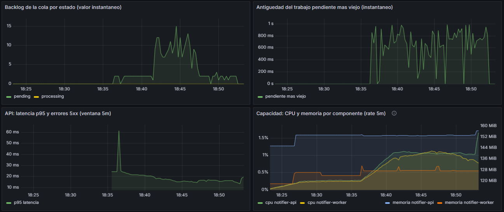

**Interpretación.** La alerta se resolvió cuando se quitó la falla y el tráfico seguía muy por encima de
0,02 intentos/s: el tráfico terminó ~18:52, después de resolverse ~18:49. La recuperación no se debió a
falta de tráfico. `NotifierQueueDelayHigh` no se disparó. El pendiente más viejo se mantuvo bajo ~1 s
porque el incidente degrada al proveedor y no la capacidad; los reintentos tienen backoff de 5 s y 10 s.
Eso es lo esperado y no demuestra un fallo de la regla.

## Interpretación

En las dos corridas la alerta dejó de estar en firing cuando el lote con falla terminó y los intentos
cayeron por debajo del mínimo de tráfico (0,02 intentos/s), antes de reiniciar el worker sin falla. La
recuperación demostrada es por falta de tráfico, no una recuperación limpia tras corregir la causa con
tráfico sano todavía presente. Es una limitación de la regla y de esta demostración. Esa limitación
corresponde a las corridas locales; la corrida en K3s la superó.

## Hipótesis

La hipótesis sobre la recuperación con tráfico sostenido sí quedó verificada en K3s: al quitar la falla
el tráfico seguía muy por encima de 0,02 intentos/s. Está en la subsección del incidente de MET-07.

Sigue sin demostrarse el disparo de `NotifierQueueDelayHigh`. En las capturas locales permanece en 0
active; eso muestra que ahí no disparó, no que la condición no pueda cumplirse. En K3s tampoco se disparó,
y es lo esperado: el incidente degradó al proveedor, no la capacidad. Habría que provocarlo degradando la
capacidad del worker (por ejemplo, detenerlo o limitarlo), no el proveedor.
